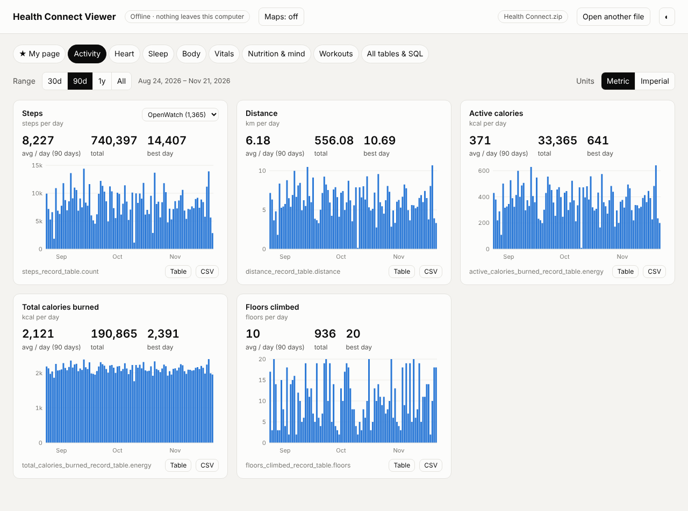

# Health Connect Viewer

An offline dashboard for your Android **Health Connect** export. It's a single HTML file: download it, open it in your browser, drop in your export, and explore steps, heart rate, sleep, weight, vitals, nutrition and workouts.

**Your health data never leaves your computer.** The file contains everything it needs, including the database engine, and a built-in security policy stops it from contacting the internet. The one exception is the optional workout-map feature, which is off until you turn it on (see [Privacy](#privacy)).



*Screenshots use randomly generated test data.*

## Download and use

1. **Get the viewer.** Download [`dist/health-connect-viewer.html`](dist/health-connect-viewer.html) (on that page, use the "Download raw file" button). That one file is the whole app.
2. **Export your data from your phone** (Android 14 or newer):
   Settings → search **Health Connect** → **Manage data** → **Backup and restore** → **Scheduled export**.
   Pick a cloud storage location and a schedule. There's no "export now" button, so wait for the first export to run, then download `Health Connect.zip` to your computer.
3. **Open the viewer** in Chrome, Edge, Firefox or Safari, and drop the `.zip` (or the `.db` file inside it) onto the page.

Health Connect holds data from every app that writes to it, including [OpenVitals](https://github.com/Hale-MTU/OpenVitals), Google Fit, Samsung Health, and fitness watches.

## Features

| Tab | What you get |
|---|---|
| **★ My page** | Your own dashboard. Add any chart, any database table, or your own SQL query shown as a table, line, bar, or scatter chart. You can reorder items, resize them, and choose chart or table view. The layout is saved in your browser; you can export it as a JSON file, or print the page / save it as a PDF. |
| **Activity** | Steps, distance, active and total calories, floors, elevation |
| **Heart** | Heart rate (daily average with a low–high band), resting heart rate, HRV |
| **Sleep** | Sleep stages per night (deep / light / REM / awake); bedtime and wake time as scatter plots, each with a dashed average line |
| **Body** | Weight, body fat, lean, bone and water mass, height |
| **Vitals** | Blood pressure, blood oxygen, respiratory rate, body and basal temperature, blood glucose, VO₂ max |
| **Nutrition & mind** | Hydration, calories eaten, protein, carbs, fat, mindfulness minutes |
| **Workouts** | Weekly minutes, a list of sessions, and session details: heart rate during the workout, distance, pace, route shape, and a GPX download |
| **All tables & SQL** | Browse every table in the export, run read-only SQL, download any result as CSV |

Every chart has hover tooltips, a table view, and CSV download. Other features:

- **Date range:** 30 days, 90 days, 1 year, or all. Longer ranges switch to weekly or monthly averages automatically.
- **Units:** metric or imperial.
- **Light and dark mode.**
- **Source picker:** when several apps record the same data (for example a phone and a watch both counting steps), adding them together would double-count. Totals show one app at a time, starting with the app that has the most records; switch apps with the dropdown on the chart.


## Privacy

- The page's Content-Security-Policy sets `connect-src 'none'`, so scripts can't send any data over the network.
- With **Maps** off (the default), the page makes no network requests at all.
- With **Maps** on, the browser downloads map images for the workout route you're looking at. Those requests tell the map provider which area the route covers, along with your IP address. No health data is sent. Choose the provider in the Maps dialog:
  - **OpenTopoMap:** the default. Free, no key needed.
  - **CARTO Voyager:** needs a [free API key](https://carto.com/basemaps/apikey/).
  - **OpenStreetMap:** its servers require a `Referer` header, which browsers don't send for pages opened as local files. So it usually works only if you serve the viewer from a web server, including a local one such as `python -m http.server`.
  - **A custom tile URL** of your choice.
- Settings (units, maps, your My page layout) are stored in your browser's `localStorage`. Your health data is never stored there.


## How the export is read

The Health Connect export is a SQLite database (`health_connect_export.db`) inside a zip file. Table and column names follow Android's Health Connect storage code in AOSP ([`packages/modules/HealthFitness`](https://android.googlesource.com/platform/packages/modules/HealthFitness/)), for example `steps_record_table.count`, `heart_rate_record_series_table.beats_per_minute`, `sleep_stages_table.stage_type`, and `exercise_route_table.latitude`.

How values are stored:

- Mass is in grams, energy in calories (÷1000 for kcal), volume in litres, and length in metres.
- Times are milliseconds since 1970 (UTC). Zone offsets are in seconds. Days are counted in the time zone each record was made in.
- Exercise types and sleep stages use the platform (`android.health.connect`) values. These are different from the Jetpack library's values.

If a column the viewer expects is missing, it falls back to the first numeric column in that table and marks the chart "guessed column". Every chart's footer names the table and column it reads, so mismatches are easy to spot. Please [open an issue](https://github.com/SaliCyclic/Health-Connect-Viewer/issues) with the table and column names, but **never your data**.

## Limitations

- The whole database is loaded into memory. Exports of several hundred MB take a minute or so and need a few GB of free RAM.
- Data that an app keeps only inside itself, and doesn't write to Health Connect, isn't in the export. For example, OpenVitals' cycle-journal notes and symptoms need that app's own export.
- The viewer has been tested against synthetic exports built to the AOSP schema. Reports from real exports are very welcome.

## Building from source

The app source is [`src/viewer.html`](src/viewer.html). The build inlines [sql.js](https://github.com/sql-js/sql.js) (SQLite compiled to WebAssembly) and [fflate](https://github.com/101arrowz/fflate) (unzip) to produce the single-file `dist/health-connect-viewer.html`.

```sh
npm install
npm run build
```

### Tests

```sh
pip install playwright && playwright install chromium
python tests/make_fake_export.py   # writes a random export to tests/out/
python tests/test_viewer.py        # set CHROME=/path/to/chrome to use an installed browser
```

The test opens the built file in light and dark mode and fails on any of the following:

- a page error
- an empty tab
- a missing average line on the scatter plots
- My page losing its layout after a reload
- any network request while maps are off
- any request other than map images while maps are on

Screenshots are saved to `tests/screenshots/`.

Never commit real health exports. `.gitignore` already excludes `*.db` and `*.zip`.

## License

[MIT](LICENSE). The bundled sql.js and fflate are also MIT-licensed; see [THIRD_PARTY_NOTICES.txt](THIRD_PARTY_NOTICES.txt). Map images come from their providers under those providers' own terms.

Health Connect is a trademark of Google LLC. This project isn't affiliated with Google.
