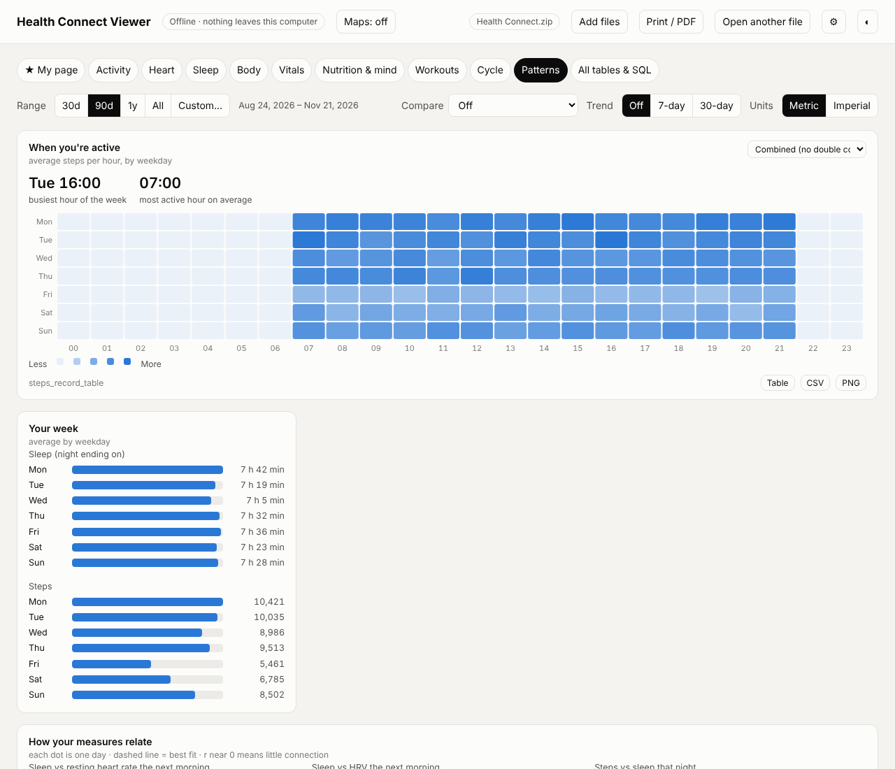
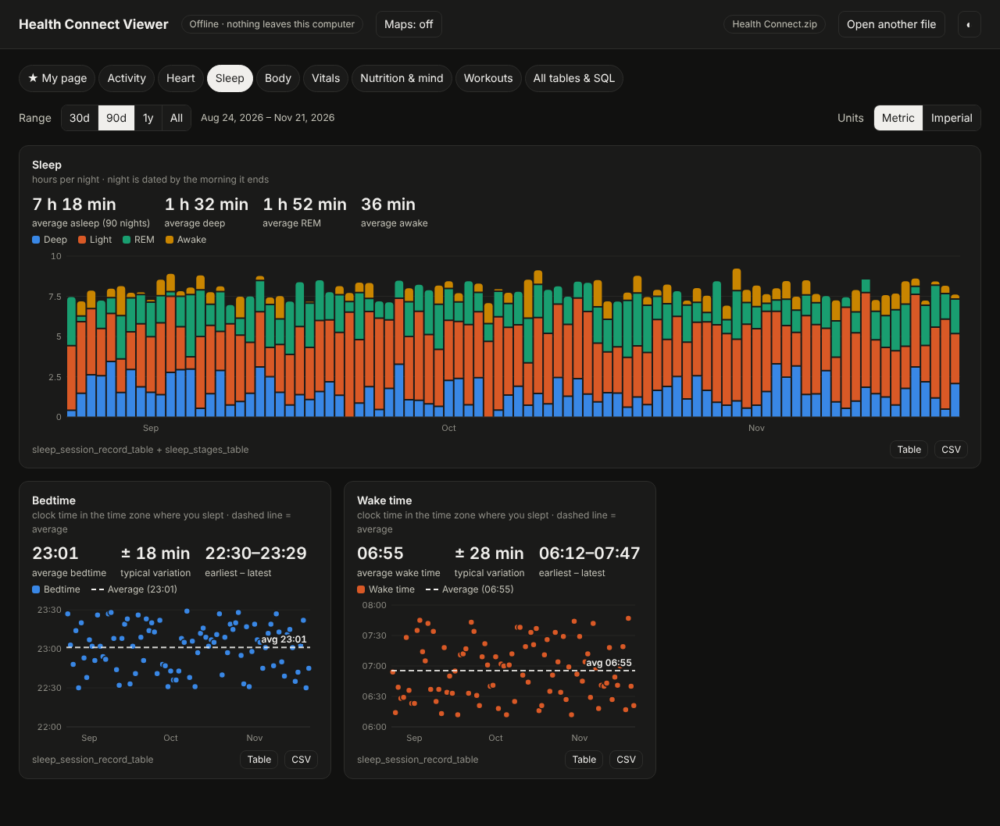
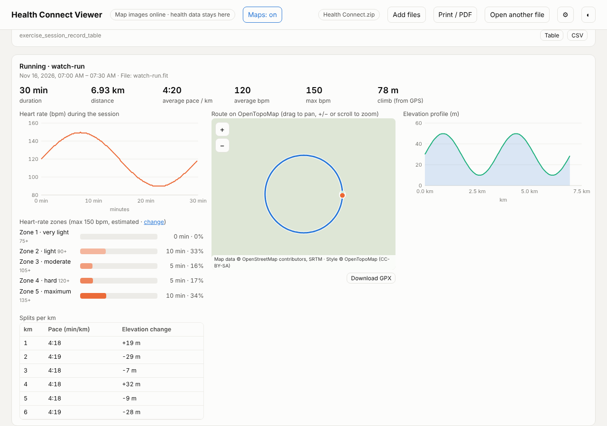

# Health Connect Viewer

An offline dashboard for your Android **Health Connect** export. To use: Open the html file in your browser, and drop in your export. You can view steps, heart rate, sleep, weight, vitals, nutrition, workouts and cycles as well as build your own dashboard page and print it as a report.

**Your health data never leaves your device.** The file contains everything it needs, including the SQLite database engine, and a built-in security policy stops it from sending anything over the network. The only exception is optional map images for workout routes, which stay off until you turn them on (see [Privacy](#privacy)).


*All screenshots use randomly generated test data.*

## Get started

1. **Open the viewer.** Use the online copy at **https://salicyclic.github.io/Health-Connect-Viewer/**, or download [`dist/health-connect-viewer.html`](dist/health-connect-viewer.html) (on that page, use the "Download raw file" button) and open it from your computer. Each [release](https://github.com/SaliCyclic/Health-Connect-Viewer/releases) also has the file attached. Either way, your export is read inside your browser. The online copy only serves the page and never receives your data. In Chrome or Edge you can install the online copy as an app, and it then works offline.
2. **Export your data on your phone** (Android 14 or newer):
   Settings → search **Health Connect** → **Manage data** → **Backup and restore** → **Scheduled export**.
   Pick a cloud storage location and a schedule. There's no "export now" button, so wait for the first export to run, then download `Health Connect.zip`.
3. **Drop the `.zip`** (or the `.db` file inside it) onto the viewer. You can drop extra files at the same time, or add them later with **Add files**:
   - workout files: **GPX**, **TCX** or **FIT** (from most watches and sports apps)
   - an **OpenVitals cycle-journal backup** (`openvitals-cycle-journal.json`), which adds symptoms, ratings and notes to the Cycle tab

Health Connect holds data from every app that writes to it: [OpenVitals](https://github.com/Hale-MTU/OpenVitals), Google Fit, Samsung Health, fitness watches and more.

## What's inside

| Tab | What you get |
|---|---|
| **★ My page** | Your own dashboard. Add any chart, any database table, or your own SQL query shown as a table, line, bar or scatter chart. Reorder, resize, and choose chart or table view; only the item you change is redrawn. The layout is saved in your browser and can be exported as a file. |
| **Activity** | Steps, distance, active and total calories, floors, elevation |
| **Heart** | Heart rate (daily average with a low–high band), resting heart rate, HRV |
| **Sleep** | Sleep stages per night; bedtime and wake time with average lines and typical variation |
| **Body** | Weight, body fat, lean, bone and water mass, height |
| **Vitals** | Blood pressure, blood oxygen, respiratory rate, body and basal temperature, blood glucose, VO₂ max |
| **Nutrition & mind** | Hydration, calories eaten, protein, carbs, fat, mindfulness minutes |
| **Workouts** | Weekly minutes, personal records per workout type, and a session list. Each session shows heart rate, heart-rate zones, pace or speed, splits per km or mile, the elevation profile, the route (optionally on a real map), and a GPX download. Workout files you add appear here too. |
| **Cycle** | Cycle and period lengths, the expected next period, and a calendar shaded by flow. With an OpenVitals journal: symptom counts, pain, mood and energy ratings, and notes. |
| **Patterns** | When you're active (steps by hour and weekday), your week (sleep and steps by weekday), and how measures relate: scatter plots with a best-fit line and correlation |
| **All tables & SQL** | Browse every table, run read-only SQL (`:from`/`:to` follow the date range), download any result as CSV, and copy a schema report for bug reports |

On every chart:

- **Reading values:** hover, tap or use the keyboard (focus a chart, then ←/→, Home/End, Esc) to read values.
- **Saving:** see the numbers as a table, or download CSV or PNG.
- **Date range:** 30 days, 90 days, 1 year, all, or a custom range. Long ranges switch to weekly or monthly averages.
- **Trend and comparison:** add a **7- or 30-day trend line**, or **compare** with the previous period or the same period last year.
- **Goals:** daily goals (steps, sleep, hydration, mindfulness, active calories, weekly workout minutes) show as a dotted line, with the number of days you reached them. Set them in ⚙ Settings.
- **Display:** metric or imperial units, light and dark mode, and a phone-friendly layout.
- **Printing:** **Print / PDF** prints the current tab as a clean report, always in the light theme.



## Counting each app once

When several apps record the same thing (a phone and a watch both counting steps, or both logging the same night's sleep), simply adding them up double-counts. By default the viewer combines them the way Health Connect does:

- **Totals** (steps, distance, calories, floors…): where records from different apps overlap in time, only the highest-priority app's record counts for that time.
- **Sleep sessions and workouts:** a session is dropped if a higher-priority app has one covering more than half of it.
- **Averages** (resting heart rate, weight…): the "Top-priority app each day" option uses one app per day.

Priority comes from your own Health Connect settings (Settings → Health Connect → App permissions → data priority) when the export includes them. Otherwise, apps with more records rank higher. Every chart has a source menu to switch to a single app or to "all sources added up".



## Big exports

The viewer runs the database in a background worker, so the page never freezes while a file opens or a query runs.

For large exports, the online copy (or any web server) can use a **low-memory mode**. The export is streamed into a temporary copy in the browser's private storage, and the viewer reads it from there instead of holding it all in memory. The copy is deleted when you open another file and whenever the viewer starts. By default this mode is used automatically for big files; you can change that in ⚙ Settings.

Browsers don't allow this storage for pages opened directly as files. In that case the export is held in memory, which needs RAM of about twice the unzipped size.

The first time a heart-rate chart is shown, the viewer reads every heart-rate sample once to total them per day. After that, ranges, units and My page edits reuse the totals.

## Privacy

- The page's Content-Security-Policy sets `connect-src 'none'`, so its scripts can't send data anywhere. The database worker inherits the same policy.
- With **Maps** off (the default), the page makes no network requests at all, apart from the online copy loading itself.
- With **Maps** on, the browser downloads map images for the workout route you're looking at. Those requests tell the map provider which area the route covers, along with your IP address. No health data is sent. Choose the provider in the Maps dialog:
  - **OpenTopoMap:** the default. Free, no key needed.
  - **CARTO Voyager:** needs a [free API key](https://carto.com/basemaps/apikey/).
  - **OpenStreetMap:** its servers require a `Referer` header, which browsers don't send for pages opened as files. It works in the online copy.
  - **A custom tile URL** of your choice.
- The online copy's offline-app support (a service worker) caches only the viewer's own page and icons. It never sees your files.
- Settings (units, goals, maps, your My page layout) are stored in your browser's `localStorage`. Your health data isn't.



## How the export is read

The Health Connect export is a SQLite database (`health_connect_export.db`) inside a zip file. Table and column names follow Android's Health Connect storage code in AOSP ([`packages/modules/HealthFitness`](https://android.googlesource.com/platform/packages/modules/HealthFitness/)), for example `steps_record_table.count`, `heart_rate_record_series_table.beats_per_minute`, `sleep_stages_table.stage_type`, `exercise_route_table.latitude`, and `health_data_category_priority_table.app_id_priority_order`.

How values are stored:

- Mass is in grams, energy in calories (÷1000 for kcal), volume in litres, and length in metres.
- Times are milliseconds since 1970 (UTC). Zone offsets are in seconds. Days are counted in the time zone each record was made in.
- Exercise types, sleep stages and data categories use the platform (`android.health.connect`) values. These are different from the Jetpack library's values.

If a column the viewer expects is missing, it falls back to the first numeric column in that table and marks the chart "guessed column". Every chart's footer names the table and column it reads.

**Found a chart that looks wrong?** Open "All tables & SQL", click **Copy schema report** (table and column names only, never values) and [open an issue](https://github.com/SaliCyclic/Health-Connect-Viewer/issues/new/choose). Please never attach your export or screenshots that show your values.

## Limitations

- The viewer has been tested against synthetic exports built to the AOSP schema. Reports from real exports are very welcome.
- Data that an app keeps only inside itself, and doesn't write to Health Connect, isn't in the export. For OpenVitals' cycle journal, add its own backup file.
- The FIT reader handles the common record and session messages (GPS, altitude, heart rate, distance, sport). It ignores laps, developer fields and other messages.
- Correlations show what tends to move together, not what causes what.

## Developing

The source is in [`src/`](src/):

- `index.html`: the page shell
- `css/`: the styles
- `js/`: the app, in numbered files (core, database, sources, charts, cards, sleep, workouts, patterns, cycle, imports, widgets, tables, app)
- `worker/`: the database worker
- `pwa/`: the offline-app files

`npm run build` puts it all together with [SQLite's official WebAssembly build](https://sqlite.org/wasm) and [fflate](https://github.com/101arrowz/fflate) (streaming unzip) into the single-file `dist/health-connect-viewer.html`.

```sh
npm ci
npm run build
```

### Tests

```sh
pip install playwright && playwright install chromium
python tests/make_fake_export.py   # random export + GPX/TCX/FIT/cycle-journal samples in tests/out/
python tests/test_viewer.py        # set CHROME=/path/to/chrome to use an installed browser
python tests/perf_mypage.py        # optional: times My page drawing and editing
```

`test_viewer.py` runs about 70 checks in light mode, dark mode, on a phone-sized screen, and on a local web server. Among other things, it checks that:

- every tab draws without errors
- combined sources match the top-priority app exactly, and overlapping sleep is removed
- trend, comparison, goal, custom range, PNG export, keyboard reading and the schema report work
- My page edits touch only one widget and survive a reload
- the GPX, TCX and FIT imports work, as do the workout zones and splits
- no request is made with maps off, and only map images are requested with maps on
- low-memory mode works, and the offline app opens without a connection

Screenshots are saved to `tests/screenshots/`.

[GitHub Actions](.github/workflows/ci.yml) builds the page, checks that the committed `dist/` matches the source, and runs the tests on every push and pull request. Pushing a tag like `v2.0.0` [publishes a release](.github/workflows/release.yml) with the viewer attached.

See [CONTRIBUTING.md](CONTRIBUTING.md) for more. Never commit real health exports. `.gitignore` already excludes `*.db` and `*.zip`.

## License

[MIT](LICENSE). Bundled third-party code: SQLite (public domain) and its WebAssembly build (Apache-2.0 packaging, MIT/NCSA Emscripten glue), and fflate (MIT). See [THIRD_PARTY_NOTICES.txt](THIRD_PARTY_NOTICES.txt). Map images come from their providers under those providers' own terms.

Health Connect is a trademark of Google LLC. This project isn't affiliated with Google.
